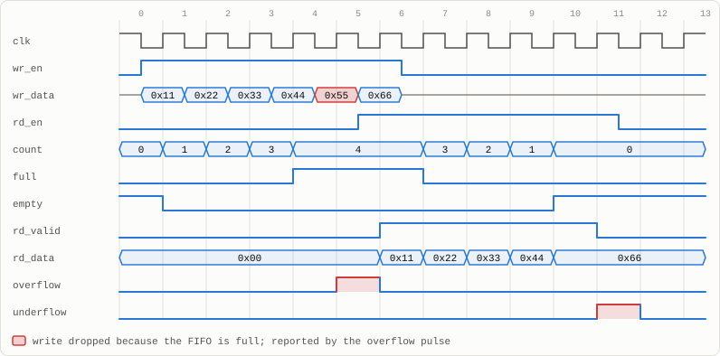
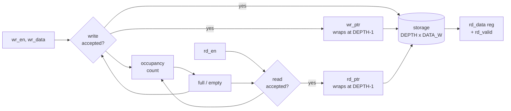
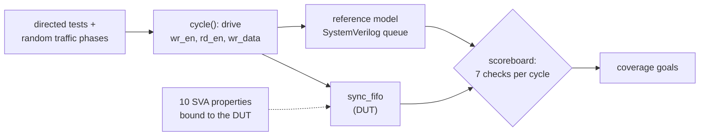

# Synchronous FIFO & Self-Checking RTL Verification

[](https://github.com/Divabhattacharya/synchronous-fifo/actions/workflows/tests.yml)


A parameterized synchronous FIFO in SystemVerilog, verified with a
**self-checking testbench**: a reference-queue scoreboard checks every output
on every cycle, and **10 concurrent assertions** are bound to the design. The
test runs three FIFO configurations in parallel, including a non-power-of-two
depth.

<p align="center">
  <picture>
    <source media="(prefers-color-scheme: dark)" srcset="docs/waveform-dark.svg">
    
  </picture>
  <br>
  <sub>A 4-deep FIFO, captured from simulation. Four writes fill it; the fifth (0x55) is dropped
  and flagged by <code>overflow</code>. A read and a write while full both proceed (0x11 out, 0x66 in).
  Four reads then drain it in order, and one more read is flagged by <code>underflow</code>.</sub>
</p>

## At a glance

| | |
|---|---|
| **Parameters** | `DATA_W` (any width), `DEPTH` (any value ≥ 2, not only powers of two) |
| **Pointers** | circular read/write pointers that wrap explicitly at `DEPTH − 1` |
| **Status** | occupancy `count` (0 … DEPTH), `full`, `empty` |
| **Errors** | write while full → dropped + one-cycle `overflow`; read while empty → ignored + one-cycle `underflow` |
| **Read + write in the same cycle** | both proceed, even when full; at empty the read underflows and the write is accepted |
| **Read port** | registered `rd_data` with a one-cycle `rd_valid` |
| **Reset** | asynchronous, active-low; clears pointers, count, flags and `rd_data` |
| **Verification** | 3 configurations · 60,540 cycles · 423,843 scoreboard checks · 10 SVA properties · **0 errors** |
| **Quality** | Verilator `-Wall` lint clean (RTL, testbench and assertions); Yosys synthesis clean |

## Design



The accept logic is the core of the design:

```systemverilog
assign rd_accept = rd_en && !empty;
assign wr_accept = wr_en && (!full || rd_en);   // a read frees a slot this cycle
```

| `wr_en` | `rd_en` | State | Result |
|:---:|:---:|---|---|
| 1 | 0 | not full | write; count + 1 |
| 1 | 0 | full | write dropped; `overflow` pulse |
| 0 | 1 | not empty | read; count − 1 |
| 0 | 1 | empty | read ignored; `underflow` pulse |
| 1 | 1 | empty | write accepted, read ignored; `underflow` pulse; count + 1 |
| 1 | 1 | otherwise | both accepted (including when full); count unchanged |

## Verification



- **Scoreboard.** Every cycle goes through one task, `cycle()`. It drives the
  inputs, predicts the outcome from a reference queue (`push_back` /
  `pop_front`), and after the clock edge checks `rd_valid`, `rd_data` (and so the
  ordering), `count`, `full`, `empty`, `overflow` and `underflow`.
- **Assertions** (`sva/sync_fifo_sva.sv`, attached with `bind`). These check
  internal invariants the outputs alone cannot show: the pointers stay in range,
  the distance between the pointers equals the count, and the count changes by
  exactly +1 / −1 / 0. They also check the overflow, underflow and `rd_valid`
  pulse definitions.
- **Coverage goals.** The test fails if it never reaches overflow, underflow,
  full, a read+write at empty, at mid level or at full, or a wrap of either
  pointer.

| Test | What it exercises |
|---|---|
| Reset values | count, flags and strobes after power-on reset |
| Fill + overflow | `full` asserts exactly at DEPTH; extra writes are dropped and flagged |
| Drain + underflow | data comes out in order; extra reads are ignored and flagged |
| Simultaneous read/write | at empty, at occupancy 1 and at full |
| Pointer wraparound | half-full FIFO streamed for 8 × DEPTH cycles |
| Random traffic | 6 phases (write-heavy, read-heavy, balanced, busy, sparse, mixed), 20,000 cycles |
| Reset with data inside | async reset while `rd_valid`, `overflow` or `underflow` is active; no stale data afterwards |

Results for the three configurations, which run in parallel:

| Configuration | Cycles | Writes | Reads | Overflows | Underflows | R+W at full | Write-pointer wraps | Checks | Errors |
|---|---:|---:|---:|---:|---:|---:|---:|---:|---:|
| 8 bit × 16 | 20,301 | 8,034 | 8,004 | 3,109 | 2,527 | 914 | 501 | 142,128 | 0 |
| 16 bit × 7 | 20,162 | 7,731 | 7,720 | 3,234 | 2,748 | 1,025 | 1,102 | 141,155 | 0 |
| 32 bit × 2 | 20,077 | 6,997 | 6,993 | 4,064 | 3,332 | 2,543 | 3,498 | 140,560 | 0 |

### The testbench catches real bugs

Each of these bugs was injected into the RTL on its own, and every one was caught:

| Injected bug | Caught by |
|---|---|
| `full` asserted one entry early | assertion `a_flag_defs` + scoreboard |
| No overflow protection (writes accepted when full) | assertion `a_count_range` + scoreboard |
| Pointers wrap at 2^N instead of DEPTH | assertion `a_ptr_range` (only the 16 × 7 configuration exposes it) |
| Write dropped on a read+write while full | assertion `a_count_hold` + scoreboard |
| `underflow` never raised | assertion `a_underflow` + scoreboard |
| Count increments on a simultaneous read+write | assertion `a_ptr_distance` + scoreboard |
| Read data taken from the write pointer | scoreboard (ordering) |
| `rd_valid` not cleared by reset | scoreboard (reset check) |

## Run it

Requires Verilator 5 and Yosys.

```bash
make lint     # verilator --lint-only -Wall at three parameter sets
make test     # build + run the testbench with assertions enabled
make synth    # Yosys synthesis of the 8 x 16 configuration
make wave     # VCD trace in build/sync_fifo.vcd
```

Synthesis of the 8 × 16 configuration (Yosys, generic cells): 152 flip-flops,
128 of which are the storage array.

## Repository layout

```
rtl/sync_fifo.sv          the FIFO
sva/sync_fifo_sva.sv      10 concurrent assertions + bind
tb/fifo_test.sv           scoreboard, directed + random tests, coverage goals
tb/tb_top.sv              runs three configurations in parallel
docs/                     waveform figures
Makefile
```
